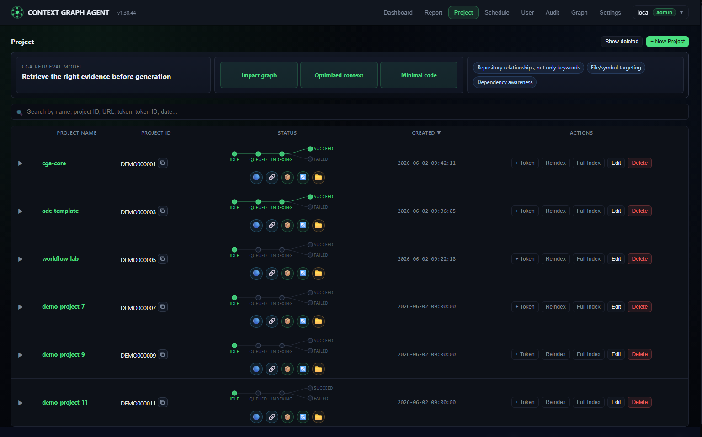
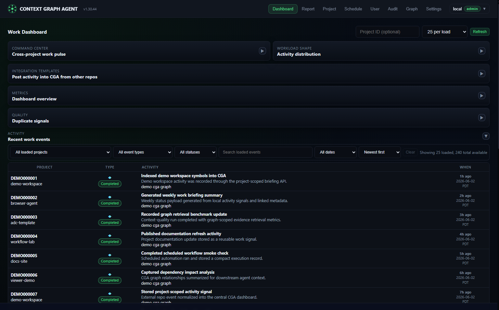
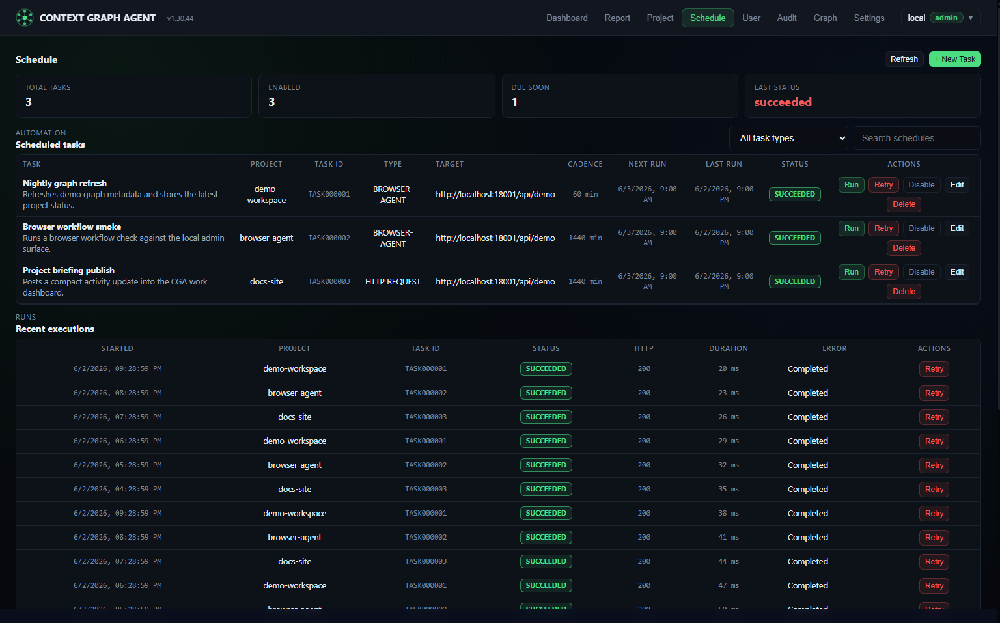
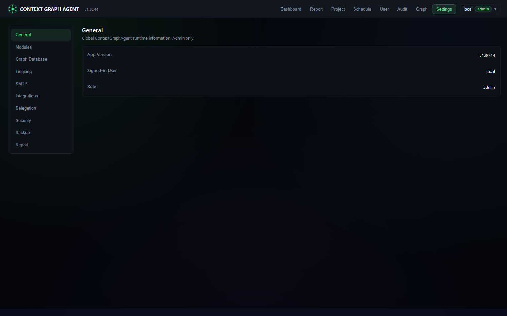
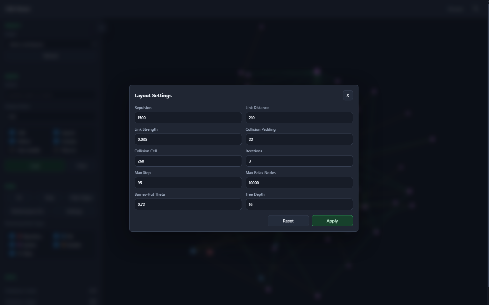
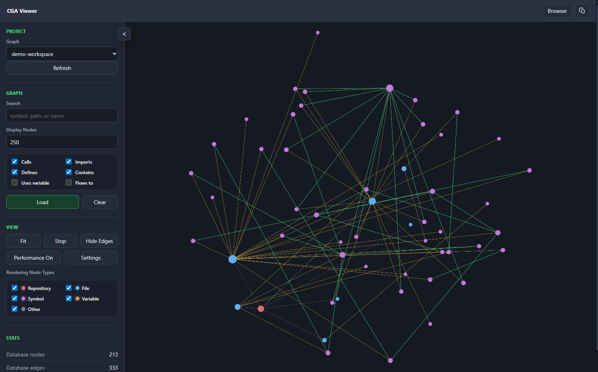

[Ask DeepWiki](https://deepwiki.com/nascousa/cga)

# CGA (Context Graph Agent)

- **Version:** 1.30.132
- **Status:** Plugin controls, compact ADC, unified reports, maintenance controls and cross-platform Relay source prepared for review; formal releases remain subject to approval and signing gates
- **Author:** Nate Scott
- **Date:** 2026-11-11 (release-readiness status)

The source/runtime version above is not a published-release claim. The latest
published GitHub release is
[v1.30.113](https://github.com/nascousa/cga/releases/tag/v1.30.113);
v1.30.125 remains an unpublished draft. See
[current release readiness](docs/PUBLISHING.md#current-release-readiness-2026-11-10)
for verified checks and the remaining signing gate.

CGA, aka Context Graph Agent, is a local-first graph context service that gives AI coding agents focused code evidence instead of dumping whole files or broad search results into prompts.

CGA is dedicated to AI-FIRST engineering teams that want local, evidence-backed context for agentic development workflows.

**ADC** stands for **Agent Development Constitution**, CGA's centrally managed
framework for agent development rules and project governance.
The central ADC master is **1.2.4** (2026-11-11), adding mandatory fixed project
ports, including previews and ownership-safe conflict cleanup. Existing project
adoption remains explicit; see the [ADC governance notes](docs/adc-framework.md#fixed-project-ports-and-conflict-cleanup)
and [local endpoint policy](docs/runtime-operations.md#fixed-local-endpoint).

In the published 2026-06-02 live multi-project benchmark, CGA reduced prompt tokens by **90.44%** on average while lowering Hallucination Pressure Score by **13.34%** across **102 real-code cases**. This is a historical pre-answer HPS snapshot; it is not a model task-completion result.

## For AI Coding Agents

CGA is related to a knowledge graph, but it is narrower and more execution-oriented: it parses source code into an AST-backed graph of files, symbols, imports, calls, definitions, containment, dependencies, and lightweight data flow. The agent queries that graph before opening raw files, then expands only the few excerpts needed for the task.

That makes CGA different from embedding-only RAG or broad text search:

- **Graph first:** retrieve connected symbols, dependency paths, and evidence-bearing excerpts before generation.
- **File reads second:** open raw source only when exact line-level context is needed.
- **Local-first:** keep repository context, indexes, and operational evidence under the developer or team runtime.
- **Measurable:** compare broad source context against graph-scoped context with deterministic context-quality benchmarks.

For the short answers to common questions from agent builders, see [docs/faq.md](docs/faq.md).


## Why CGA

- Retrieves target symbol excerpts, nearby relationship context, dependency paths, and recent project facts.
- Indexes repository files, symbols, calls, imports, and lightweight data flow into FalkorDB.
- Exposes MCP-compatible tools so AI coding agents can query repository relationships before generation.
- Keeps project context local-first while still offering an Admin Dashboard for indexing, settings, schedules, and work activity.
- Helps agents answer, edit, and search through repositories with less prompt waste and lower evidence ambiguity.

## Quick Start

Administrators can manage ADC at `/admin/adc`: publish immutable releases, pin
project baselines, review upgrades, record project-specific changes and export
traceable onboarding bundles. See [ADC governance](docs/adc-framework.md#integrated-adc-governance).
Remote clients can read approved ADC through the authenticated MCP endpoint or
Desktop Relay, including revision history, diffs and file hashes. Relay provides
preview-first local synchronization; local edits are never silently overwritten.
See [remote ADC interfaces](docs/adc-framework.md#remote-adc-interfaces).

For macOS CLI, Linux tray, user services and
signed-release prerequisites, see the [Desktop Relay guide](src/cga-relay/README.md).
Unix source/candidate support does not imply a signed public platform release.

### Option A: Docker Desktop Release

Use this path for the easiest local Windows launch.

1. Install Docker Desktop.
2. Download `CGA-Docker-Desktop-<version>.zip` from the release artifacts.
3. Unzip it and double-click `start-cga-desktop.cmd`.

Open `http://localhost:18001/admin`.

### Option B: Run From Source

Use this path for development from a fresh clone.

```bash
git clone https://github.com/nascousa/cga.git
cd cga
cp .env.example .env
docker compose --profile dev up --build
```

Windows PowerShell equivalent:

```powershell
Copy-Item .env.example .env
docker compose --profile dev up --build
```

Open:

- Admin UI: `http://localhost:8001/admin`
- MCP discovery: `http://localhost:8001/mcp`
- FalkorDB Browser: `http://localhost:13000`

For the repository-root desktop stack, use:

```powershell
Copy-Item .env.example .env
./src/scripts/start-desktop.ps1 start
```

That stack opens the Admin UI at `http://localhost:18001/admin`.

## What You Get

Admin navigation follows the daily workflow: **Dashboard → Project → Graph →
Automation → ADC → Audit**. The user dropdown separates **Profile** and
**Sign out** from an admin-only **Administration** group: **Users and access**,
**Plugin management**, and **System settings**. Administration entries retain
their existing routes, active-page indicators and SVG icons. Navigation remains
subject to the existing role permissions.
Dashboard, Automation and Report entry points also depend on enabled plugins.

### Maintenance Controls (Source Candidate)

- **Security > Audit retention:** capacity and cleanup status, policy-bound
  preview and bounded cleanup. Automatic deletion defaults off; enabling it
  requires explicit administrator confirmation.
- **Change Logs:** frozen product history and clearly separated Unreleased
  changes; product-change notes are checked in CI and frozen by version iteration.
- **Upgrade:** newer formal release detection and change notifications, with
  confirmation-gated installation through an independent host executor. Trusted
  signed metadata, compatible schemas, fresh backups and original-port/image
  rollback checks are required; the ordinary API receives no Docker socket.

These features are implemented in source, **not deployed to the current local
1.30.132 runtime**. Online installation additionally requires operator provisioning
and a newer signed release; it supports single-process JSON Docker Compose first,
not Relay/native installers or automatic schema migrations. See
[maintenance operations](docs/runtime-operations.md#audit-retention-change-logs-and-confirmed-updates)
and [release-note/signing workflow](docs/PUBLISHING.md#change-logs-and-trusted-update-manifests).

### Selectable First-Party Plugins

Open **User menu → Administration → Plugin management** to install, enable, disable or uninstall
optional capabilities. Existing installations default to all bundled plugins;
new distributions can contain only the plugins their users need.
Choose a plugin on the left to open its settings in the right-hand panel.
Search, filters and installation selections stay visible on desktop; narrow
screens show one pane at a time. Larger settings use tabs without losing edits.
Installation selection,
runtime defaults and browser-local report preferences are saved separately.
Installed-but-disabled plugins remain configurable; configuration checks do
not execute external jobs or claim provider connectivity.
The overview supports search, category/status filters and sorting without
discarding pending installation or enable changes.

| Plugin | Capability |
|---|---|
| `automation` | Scheduled-task management and run history |
| `browseragent` | BrowserAgent page checks and browser artifacts |
| `workflows` | External agent activation and HTTP workflows |
| `azure_policy_change_monitor` | Read-only Azure Policy monitoring |
| `briefing` | Work Dashboard and activity summaries |
| `reports` | Unified interactive reports, PDF/data exports and retained weekly history |
| `notifications` | Optional webhook and SMTP delivery |
| `evaluation` | Context benchmarks and background trace evaluation |

**ADC governance and system Audit remain core, not plugins.** Graph/MCP,
identity, projects, agent memory, backups and the scheduling engine also remain
core. Uninstalling an optional plugin retains its settings and history. Reports
work without the briefing plugin and retain existing browser-local templates
and saved reports. See the [plugin guide](extensions/README.md) for selective
Docker builds, APIs, compatibility and restart requirements.

### Core and Optional Features

Plugin development now has a paired [standard and approval policy](extensions/README.md#plugin-development-approval-and-sdk)
and [Python developer SDK](sdk/cga-plugin-sdk/README.md), packaged together with
schemas, examples and license/checksum evidence. The v1 candidate supports
reviewed first-party source integrations, not third-party hot loading. Formal
publication requires independent current-commit reviews and passing checks;
draft artifacts are not approved API/Relay updates.

- **Admin Dashboard:** project registration, user access groups, indexing status, settings, schedules, and operational views.
- **Central ADC Management:** Constitution, Amendments and Versions subtabs; compact document/change-picker and editor workspaces, collapsed publishing/baseline/history/collection tools, immutable project revisions and collection receipts, and a right-aligned ECharts Sankey for baseline-to-project revision relationships. See [ADC governance](docs/adc-framework.md).
- **3D Graph Viewer:** visual exploration of repository relationships and graph layout controls.
- **Expired login sessions:** an authenticated API response of HTTP 401 returns Admin to sign-in and stops authenticated polling. An empty graph project list with an authentication error requires signing in again; it does not mean the registered projects have been deleted.
- **MCP-compatible API:** agent-facing retrieval tools for symbols, files, dependencies, imports, variable flow, and architecture queries.
- **CGA-Relay:** local Rust relay with a Windows notification-area UI, macOS CLI and Linux AppIndicator companion, plus a headless loopback gateway. Single-instance enforcement is machine-wide on Windows and per-user on Unix. Includes backend health alerts, stdio MCP, local scan/sync, branch/ref graph routing and promotion, and OS-protected account credentials. Unix source/candidate support is not a signed-release claim. See [docs/cga-relay.md](docs/cga-relay.md).
- **Work Briefing Aggregation:** WA-compatible activity capture and briefing summaries inside CGA.
- **Harness-neutral agent memory:** project-scoped MCP and authenticated HTTP interfaces for retrieving memory and recording bounded, evidence-referenced learning candidates. See [harness integration](docs/harness-memory-integration.md).
- **AI-First Readiness And Evidence:** Admin APIs for readiness snapshots, GitHub/Azure DevOps/verification signals, evidence packs, PR evidence links, and policy-derived gates that combine graph, indexing, ADC, governance, and work activity signals.
- **Unified Report workspace (source implementation):** Audit → Report combines
  work activity, current AI-First readiness and expandable evidence. Filter by
  projects, UTC dates, type, status and text, then generate an immutable-in-session
  snapshot. Locally bundled ECharts charts support drill-down and dark/light/system
  themes. Export Mermaid-led, print-light PDF, CSV, JSON or Mermaid source.
  Activity is capped at 10,000 matching records with explicit partial-sample
  warnings; readiness is current, not a historical trend or proven AI ROI.
  PDF evidence is shortened and capped at 100 rows; CSV/JSON retain the complete
  generated snapshot. Existing policy/evidence tools and weekly drafts/history
  remain in collapsed panels. See [report operations](docs/runtime-operations.md#unified-report-workspace).
- **Schedule Automation:** admin-defined recurring jobs for BrowserAgent page tests, agent activation calls, generic HTTP tasks, and project extensions.
  The workspace opens on tasks, with execution history in a separate tab and
  advanced task fields collapsed. Project policy and PR/CI/benchmark evidence
  inputs belong to **Audit → Report → Evidence packs, policy and signal tools**,
  not Automation.
- **Project Extensions:** project-scoped extension pages and runs, starting with Azure Policy Change Monitor for cloud parity, GUID/version consistency, risky-effect scans, and Docker Desktop `/repos` path mapping.
- **Runtime Backup:** PostgreSQL and FalkorDB snapshots for local-first persistence and recovery.
- **Safe Graph Updates:** isolated generation builds retain the last successful graph on failure, with versioned parse evidence and deterministic cross-file relationships. See [graph integrity and recovery](docs/graph-reliability.md).
- **Upgrade Center:** admin-visible upgrade readiness, backup status, schema compatibility, relay guidance, and copyable upgrade commands.

## Supported Languages And Formats

CGA currently discovers and structurally indexes **51 language and format families** across **95 unique file extensions** and **8 conventional filenames**. The runtime source of truth is the dedicated dispatch in [src/backend/indexer/parser.py](src/backend/indexer/parser.py) plus the declarative registry in [src/backend/indexer/language_definitions.py](src/backend/indexer/language_definitions.py).

Support means that CGA can discover the file and map its available structure into files and, where those concepts apply, symbols, imports, calls, and lightweight variable-flow relationships. Relationship depth varies by language and syntax; declarative formats do not imply executable calls or variable flows, and this is repository-context extraction rather than compiler-equivalent type or overload resolution.

### Dedicated Parsers

| Language | Recognized files |
|---|---|
| Python | `.py` |
| TypeScript | `.ts`, `.tsx` |
| JavaScript | `.js`, `.jsx` |
| PowerShell | `.ps1`, `.psm1`, `.psd1` |
| Go | `.go` |
| Rust | `.rs` |
| Java | `.java` |

### Tree-sitter Structural Parsers

These parsers use the pinned offline grammar bundle; indexing does not download grammars at runtime.

| Language or format | Recognized files |
|---|---|
| C# | `.cs` |
| C | `.c`, `.h` |
| C++ | `.cpp`, `.cc`, `.cxx`, `.hpp`, `.hh`, `.hxx` |
| Kotlin | `.kt`, `.kts` |
| Scala | `.scala`, `.sc` |
| Swift | `.swift` |
| Ruby | `.rb`, `.rake`, `.gemspec`; `Gemfile`, `Rakefile` |
| PHP | `.php`, `.phtml` |
| Dart | `.dart` |
| Lua | `.lua` |
| Perl | `.pl`, `.pm` |
| Bash and shell scripts | `.sh`, `.bash`, `.zsh` |
| Groovy and Gradle | `.groovy`, `.gradle` |
| F# | `.fs`, `.fsx`, `.fsi` |
| Zig | `.zig` |
| Nim | `.nim`, `.nims` |
| D | `.d`, `.di` |
| Fortran | `.f`, `.for`, `.f77`, `.f90`, `.f95`, `.f03`, `.f08` |
| Pascal | `.pas`, `.pp`, `.inc` |
| R | `.r`, `.rmd`, `.rnw` |
| Julia | `.jl` |
| MATLAB | `.m` |
| Haskell | `.hs`, `.lhs` |
| OCaml | `.ml`, `.mli` |
| Erlang | `.erl`, `.hrl` |
| Objective-C and Objective-C++ | `.m`, `.mm` |
| Crystal | `.cr` |
| Solidity | `.sol` |
| SQL | `.sql` |
| GraphQL | `.graphql`, `.gql`, `.graphqls` |
| Protocol Buffers | `.proto` |
| Starlark and Bazel | `.bzl`, `.star`; `BUILD`, `BUILD.bazel`, `WORKSPACE`, `WORKSPACE.bazel`, `MODULE.bazel` |
| Nix | `.nix` |
| SCSS | `.scss` |

For the shared `.m` extension, CGA examines the source and routes Objective-C declarations such as `@interface` or `#import` to Objective-C; other `.m` files use the MATLAB parser.

### Bounded Pattern Parsers

The offline grammar bundle does not provide compatible grammars for these languages and formats. CGA therefore uses conservative, language-specific structural patterns rather than pretending to provide compiler-level semantics.

| Language or format | Recognized files |
|---|---|
| Visual Basic .NET | `.vb` |
| Ada | `.ada`, `.adb`, `.ads` |
| COBOL | `.cob`, `.cbl`, `.cpy` |
| Mojo | `.mojo`, `.🔥` |
| CMake | `.cmake`; `CMakeLists.txt` |
| Vyper | `.vy` |
| Move | `.move` |
| Cairo | `.cairo` |
| Clarity | `.clar` |
| Cadence | `.cdc` |

Files and formats not listed above are not claimed as supported by the current runtime registry.

## Screenshots

| Project Console | Work Dashboard |
|---|---|
|  |  |

| Schedule Automation | Runtime Settings |
|---|---|
|  |  |

| Graph Layout Controls | Graph Canvas Focus |
|---|---|
|  |  |

## Historical Benchmark Snapshot

The published 2026-06-02 database-backed run selected three active projects from CGA, generated 34 deterministic symbol-level cases per project, and compared broad source context against graph-scoped CG context.

| Metric | Result |
|---|---:|
| Projects | 3 |
| Cases per project | 34 |
| Total real-code cases | 102 |
| Average baseline HPS | 17.66 |
| Average CG HPS | 13.94 |
| Average HPS reduction | 13.34% |
| Average baseline tokens | 5,474.95 |
| Average CG tokens | 483.29 |
| Average token reduction | 90.44% |

The run is intentionally reported with nuance: one project's HPS increased under the conservative neighboring-context setup, while the cross-project average improved. This is a pre-answer 2026-06-02 snapshot, not evidence of model task completion. The current benchmark also supports frozen graph expansion, controlled model answers, citation scoring, and per-project regression gates; no answer-level result is claimed until that runner completes. See [docs/benchmarks/live-context-quality.md](docs/benchmarks/live-context-quality.md) for the historical table and [docs/benchmarks/README.md](docs/benchmarks/README.md) for the current workflow.

## Documentation

- [Docker Desktop bundle](deploy/docker-desktop/README.md) - one-click local distribution and release zip behavior.
- [Runtime operations](docs/runtime-operations.md) - work briefing, schedules, Azure Policy proxy operations, persistence, backup, and default local runtimes.
- [AI-first readiness](docs/ai-first-readiness.md) - readiness snapshots and observe-only evidence packs for AI-first team planning.
- [AI-first correlation contract](docs/ai-first-correlation-contract.md) - standard task, issue, PR, and activity ids for evidence packs and traces.
- [How CGA works](docs/how-it-works.md) - compact deep dive on graph-first retrieval, agent flow, LSPs, AST-Grep, and quality controls.
- [MCP query quickstart](docs/mcp-agent-query-quickstart.md) - endpoint discovery, query clients, batch mode, and CG-first strategy.
- [Harness memory integration](docs/harness-memory-integration.md) - shared learning contract, harness adaptation, authenticated MCP and HTTP usage, and current limitations.
- [FAQ](docs/faq.md) - short answers on knowledge graphs, RAG, token reduction, MCP, and benchmarks.
- [Benchmark guide](docs/benchmarks/README.md) - deterministic context-quality benchmark model and commands.
- [Live benchmark report](docs/benchmarks/live-context-quality.md) - current live multi-project benchmark summary.
- [ADC framework notes](docs/adc-framework.md) - project context governance and AI-agent operating model.
- [Publishing guide](docs/PUBLISHING.md) - release channels, maintainer preflight, tags, and public launch settings.
- [Security policy](SECURITY.md) - vulnerability reporting and security baselines.

## Community

- [Contributing](CONTRIBUTING.md)
- [Code of Conduct](CODE_OF_CONDUCT.md)
- [Security reporting](SECURITY.md)
- [Bug report template](.github/ISSUE_TEMPLATE/bug_report.yml)
- [Feature request template](.github/ISSUE_TEMPLATE/feature_request.yml)
- [Pull request template](.github/pull_request_template.md)

## Author And Attribution

CGA (Context Graph Agent) was created and authored by Nate Scott. Public documentation, release notes, desktop bundle documentation, redistributions, and project notices should preserve that attribution while keeping promotional surfaces focused on the product experience.

## License And Notices

CGA is released under the Apache License, Version 2.0. See [LICENSE](LICENSE).

- [OPEN_SOURCE.md](OPEN_SOURCE.md)
- [DISCLAIMER.md](DISCLAIMER.md)
- [NOTICE.md](NOTICE.md)
- [THIRD_PARTY_NOTICES.md](THIRD_PARTY_NOTICES.md)
- [CONTRIBUTING.md](CONTRIBUTING.md)
- [SECURITY.md](SECURITY.md)

## Star History

<a href="https://www.star-history.com/?repos=nascousa%2Fcga&type=date&legend=top-left">
 <picture>
   <source media="(prefers-color-scheme: dark)" srcset="https://api.star-history.com/chart?repos=nascousa/cga&type=date&theme=dark&legend=top-left" />
   <source media="(prefers-color-scheme: light)" srcset="https://api.star-history.com/chart?repos=nascousa/cga&type=date&legend=top-left" />
   
 </picture>
</a>
