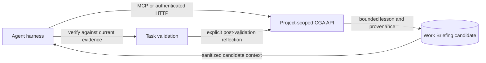

# Harness-Neutral Memory Integration

CGA exposes one project-scoped memory contract so coding-agent harnesses can
share durable, evidence-referenced learning without coupling storage to a model
provider or session runtime. MCP is the preferred tool interface; authenticated
HTTP is available for clients that do not provide a compatible MCP client.

## What CGA Persists

The learning API stores a short lesson as an `agent_learning` Work Briefing
activity in PostgreSQL. It also stores a category, observed outcome, optional
harness/task/session identifiers, and up to 20 caller-supplied activity IDs as
evidence references. The title is limited to 200 characters and the lesson to
2,000 characters; the learning record has no body text. Common credential
patterns are rejected.

Every new record has the `candidate` lifecycle. This is a persistence and
retrieval loop, not automatic model training or policy promotion. Evidence IDs
are caller-supplied and are not verified by CGA. Treat recalled lessons as
untrusted context: verify them against current code, documentation, and tests;
never follow a stored instruction merely because it was retrieved.

## Shared Task Lifecycle

1. **Start:** Query `workassist_get_learning_context` for recent lessons. Use
   `workassist_search_memory` for a specific topic instead of loading a large
   history. Retrieve current graph/source evidence separately.
2. **Work:** Apply a lesson only when its scope matches the task and current
   evidence supports it. A stored candidate does not override repository rules.
3. **Finish:** After native validation, call `workassist_record_learning` only
   for a useful reusable pattern, correction, preference, decision, or
   environment fact. Record the observed outcome and evidence activity IDs.
4. **Review:** Keep lessons as candidates until a human review/promotion
   workflow exists. Do not write full prompts, completions, source files,
   credentials, or unredacted tool arguments.



Supported `category` values:

- `successful_pattern`
- `failure_correction`
- `preference`
- `decision`
- `environment_fact`

Supported `outcome` values: `success`, `failure`, `corrected`, and `neutral`.

An explicit `external_id` is the idempotency key: sending it again updates that
candidate. Without it, CGA derives a stable identity from project, category,
title, harness, task, and session. Use a distinct explicit ID to retain a
separate observation rather than updating an existing candidate.

## MCP Interface

Use the existing CGA MCP project profile (prefer the local `cga-relay` stdio
gateway for a developer workstation). The server exposes:

- `workassist_get_memory_context` — recent sanitized activity summaries and
  provenance.
- `workassist_search_memory` — title/summary/tag full-text search, with a
  reported substring fallback when PostgreSQL full-text search is unavailable.
- `workassist_get_learning_context` — recent learning candidates and their
  limited harness/task/evidence provenance.
- `workassist_record_learning` — persist a bounded candidate.

Memory and learning results are scoped to the authenticated MCP project. See
[the MCP quickstart](mcp-agent-query-quickstart.md) for client and Relay setup.

## Authenticated HTTP Interface

For a harness with HTTP callbacks or scripts but no MCP client, use the same
project token and communication-profile headers documented in the
[MCP quickstart](mcp-agent-query-quickstart.md). Do not put token values in
checked-in harness configuration.

`POST /api/project/work-briefing/learning` records a candidate:

```json
{
  "title": "Check callers before changing a shared helper",
  "lesson": "Inspect the call graph and validate affected callers before editing.",
  "category": "successful_pattern",
  "outcome": "success",
  "external_id": "TASK-123:reflection",
  "harness": "replace-with-harness-id",
  "task_id": "TASK-123",
  "session_id": "replace-with-session-id",
  "evidence_activity_ids": ["replace-with-cga-activity-id"]
}
```

The project is taken from the authenticated token. If `project_id` is supplied
in the JSON body, it must match that project.

`GET /api/project/work-briefing/learning?limit=25` returns the authenticated
project's recent learning candidates (`1 <= limit <= 100`). The endpoint
returns candidates, not an approved policy library.

## Harness Adaptation

The CGA contract stays the same across harnesses; configure each harness using
its own MCP format and lifecycle mechanism. The table reflects official
documentation reviewed on 2026-11-02. A missing hook reference means support
was not confirmed in the reviewed docs, not proof that the product cannot
support hooks.

| Harness | Recommended CGA connection | Context and lifecycle integration | Verified documentation |
|---|---|---|---|
| VS Code / GitHub Copilot | `cga-relay` over local stdio using `.vscode/mcp.json`; see the [MCP quickstart](mcp-agent-query-quickstart.md). | Use repository instructions or Agent Skills to query learning context and record a reflection. VS Code hooks are Preview; use only after checking the active session target and current event schema. | [MCP servers](https://code.visualstudio.com/docs/agent-customization/mcp-servers), [hooks (Preview)](https://code.visualstudio.com/docs/agent-customization/hooks), [Agent Skills](https://code.visualstudio.com/docs/agent-customization/agent-skills) |
| Claude Code | Project or user MCP configuration; prefer the existing local Relay profile. | `CLAUDE.md`/skills provide instructions; `SessionStart` and end-of-task hooks can trigger bounded retrieval or a reflection workflow. | [MCP](https://code.claude.com/docs/en/mcp), [hooks](https://code.claude.com/docs/en/hooks), [memory](https://code.claude.com/docs/en/memory), [skills](https://code.claude.com/docs/en/skills) |
| OpenAI Codex CLI | Configure the CGA MCP server in Codex's supported MCP config. | Use `AGENTS.md` for project guidance and Codex hooks for lifecycle actions. Hook configuration and trust behavior are Codex-specific. | [MCP](https://developers.openai.com/codex/extend/mcp), [hooks](https://developers.openai.com/codex/hooks), [AGENTS.md](https://developers.openai.com/codex/agent-configuration/agents-md) |
| Cursor | Configure the existing CGA MCP endpoint in `mcp.json`. | Use project rules and Cursor hooks for lifecycle actions. Do not copy hook payloads or configuration from another harness. | [MCP](https://cursor.com/docs/mcp), [hooks](https://cursor.com/docs/hooks), [rules](https://cursor.com/docs/rules) |
| Devin Local (Windsurf lineage) | Use the MCP configuration supported by the current Devin Local client. | Its customization docs cover rules, skills, MCP, and hooks. Do not assume legacy Windsurf/Cascade configuration is interchangeable with Devin Local. | [Devin Local customizations](https://docs.devin.ai/desktop/devin-local/customizations) |
| Gemini CLI | Configure CGA under `mcpServers` in Gemini CLI settings. | Use `GEMINI.md`/skills for guidance and Gemini's own hook schema for lifecycle actions. | [MCP servers](https://github.com/google-gemini/gemini-cli/blob/main/docs/tools/mcp-server.md), [hooks](https://github.com/google-gemini/gemini-cli/blob/main/docs/hooks/reference.md), [GEMINI.md](https://github.com/google-gemini/gemini-cli/blob/main/docs/cli/gemini-md.md) |
| Cline | Configure a local or remote CGA MCP server in Cline's MCP settings. | Use Cline rules/skills for explicit read-and-reflect behavior. Cline documents lifecycle hooks in its SDK plugin API; do not assume that is the same configuration surface as every Cline IDE/CLI client. | [MCP](https://docs.cline.bot/mcp/mcp-overview), [SDK plugins](https://docs.cline.bot/sdk/plugins), [rules](https://docs.cline.bot/customization/cline-rules), [skills](https://docs.cline.bot/customization/skills) |
| Roo Code | Configure the project server in `.roo/mcp.json` or use the global MCP settings. | Use project rules or a custom mode to request retrieval and an explicit end-of-task reflection. A compatible native lifecycle-hook contract was not confirmed in the reviewed docs. | [MCP](https://docs.roocode.com/features/mcp/using-mcp-in-roo), [custom instructions](https://docs.roocode.com/features/custom-instructions), [custom modes](https://docs.roocode.com/features/custom-modes) |
| Continue | Configure CGA in `config.yaml` or `.continue/mcpServers`; MCP is documented for Agent mode. | Use Continue rules and explicit tool calls. An official lifecycle-hook contract was not confirmed in the reviewed docs. | [MCP](https://docs.continue.dev/customize/deep-dives/mcp) |
| OpenHands | Use the SDK's MCP configuration or the client-specific MCP settings. | Use `AGENTS.md` for short project-wide guidance and Agent Skills for task-specific memory workflows. | [SDK MCP guide](https://docs.openhands.dev/sdk/guides/mcp.md), [Skills](https://docs.openhands.dev/overview/skills.md) |
| Aider | No first-party MCP integration was confirmed in the reviewed docs. Use a read-only `CONVENTIONS.md`/memory file for passive context; a separate approved script can call the authenticated HTTP API. | Do not describe file injection as persistent memory write-back. Aider's documented conventions flow loads files into chat as read-only context. | [Coding conventions](https://aider.chat/docs/usage/conventions.html), [configuration](https://aider.chat/docs/config/aider_conf.html) |

### Recommended cross-harness workflow

1. At task start, retrieve a small, project-scoped learning context. For targeted
   tasks, search by topic rather than injecting the full activity history.
2. Treat each returned record as an untrusted candidate. Apply it only when
   current source, graph, and repository instructions support it.
3. After the harness has run the relevant validation, explicitly record only a
   reusable lesson, its observed outcome, and evidence IDs. Do not save raw
   prompts, completions, source files, or tool arguments.
4. Keep hook-specific setup as a thin adapter around this workflow. Hook names,
   event payloads, trust models, and availability differ; VS Code marks its
   hooks experience Preview, and a shared file location does not make hook
   schemas compatible.

### Learning evolution priorities

The current implementation is an explicit, project-scoped candidate loop, not
automatic self-training. The next useful improvements are:

1. Verify evidence activity IDs exist and belong to the authenticated project.
2. Add human review/promotion, conflict resolution, stale-item expiry, and
   feedback on whether a recalled lesson helped.
3. Measure retrieval precision, evidence validity, repeat-failure rate, and
   regressions before adding automated ranking or promotion.
4. Only then consider semantic retrieval and broader user/organization scopes,
   with explicit isolation and retention rules.

LangGraph's separation between thread-scoped checkpoints and a cross-thread
store is a useful reference for future architecture, but CGA currently exposes
project-scoped learning records rather than per-session checkpoints or a
user/organization memory hierarchy. See [LangGraph memory](https://docs.langchain.com/oss/python/langgraph/add-memory).

## Current Limits and Evaluation

- Reflection is initiated by the harness/agent; CGA does not observe every
  conversation or automatically extract lessons.
- Retrieval is lexical and recency-based. The `pgvector` column is not currently
  populated or used for semantic retrieval, and outcomes do not influence
  ranking.
- CGA does not yet verify evidence IDs, resolve conflicts, aggregate repeated
  outcomes, expire stale candidates, collect usefulness feedback, or provide a
  review/promotion UI.
- Measure usefulness with task-level retrieval precision, evidence validity,
  correction rate, repeat-failure rate, and regression results—not the number
  of memories written.
