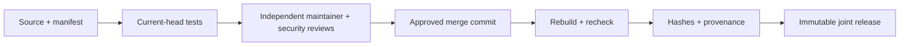

# CGA Plugin Approval and Publication v1.0.0

Status: release candidate, paired with Plugin Standard and SDK v1.0.0.

## Lifecycle

1. **Draft:** author declares scope, permissions, data flows, compatibility,
   retention, licenses and rollback; scaffold output is not approved.
2. **Submitted:** source/manifest/tests and exact artifact hashes accompany a PR
   targeting `main`. No author-provided approval field/file is authoritative.
3. **Technical validation:** `Plugin SDK tests` succeeds on the current head.
   The plugin's own integration/authorization/retention tests must also pass;
   this SDK check is not a substitute for them.
4. **Independent review:** a configured maintainer and a configured security
   reviewer, two distinct humans other than the author, approve the exact head.
   Changed commits, dismissals or a trusted change request block approval.
5. **Merged and packaged:** checkout the approved PR's merge commit, never a
   moving branch or arbitrary uploaded package. Rebuild and recheck all evidence.
6. **Released:** the protected workflow publishes an immutable joint kit,
   SHA-256 checksums and GitHub artifact attestations after repeating approval.
7. **Deprecated/revoked:** publish an advisory and replacement version; exclude
   unsafe versions from future images and use lease-aware host disable. Preserve
   evidence/data and recovery material. Emergency containment does not silently
   approve a replacement or bypass release review.

## Enforced gate and operator setup

`src/scripts/check_plugin_approval.py` reads GitHub PR/review/check metadata with
`gh api`, never a decision embedded in a plugin. It requires exact head SHA,
correct repository/main base, two distinct non-author authorized human reviews,
no outstanding trusted change request, and successful current GitHub Actions
checks. Formal publication also requires the actual merged commit. All API pages
are inspected; missing reviewer configuration/API availability fails closed.

Repository variables:

- `CGA_PLUGIN_MAINTAINERS`: comma-separated authorized GitHub logins.
- `CGA_PLUGIN_SECURITY_REVIEWERS`: comma-separated independent reviewer logins.
- `CGA_PLUGIN_REQUIRED_CHECKS`: optional comma-separated check names; defaults
  to `Plugin SDK tests`, never an empty set.

Owners must configure actual people/teams and protect `main`: required reviews,
dismiss stale approvals, require the SDK/approval checks, protect workflow/gate
changes with CODEOWNERS, and restrict administrator bypass. Configure the
`plugin-sdk-release` environment with independent required reviewers and prevent
self-review. Do not assign the author to satisfy both roles.

These settings are an **operator prerequisite**, not automatically established by
committing this policy. The investigated repository currently has no main branch
protection; do not claim remote merge protection until it is configured and
verified. The release checker remains fail-closed without the configured reviewers.
Existing approvals are not retroactively fabricated for bundled plugins.

## Developer and reviewer checklist

- [ ] Correct core/optional boundary and explicit resource ownership.
- [ ] Least privilege, external hosts, secret references and project authorization.
- [ ] Real disable/omission, errors, timeouts, output bounds and no-secret tests.
- [ ] Retention, schema/config migration, uninstall preservation and rollback.
- [ ] License/SBOM, dependency-advisory evidence and platform compatibility.
- [ ] Evaluable UI/accessibility/report/export evidence where applicable.
- [ ] Exact head approvals and passing checks, no outstanding change requests.
- [ ] Rebuilt merged-commit assets, hashes, attestation and immutable version.

Missing evidence means pending review, not approved by default. Advisory-feed
failures, skipped tests and unavailable platforms must be disclosed.

## Publication procedure

Use the `Plugin SDK release` workflow with the merged approval PR number and
version. The workflow derives the checkout from GitHub merge metadata and
verifies that package version matches the requested version. It refuses to
overwrite an existing release/tag's assets. This path publishes developer tools
only; it does not install plugins or update the API/Relay.

Consumers verify SHA-256 and `gh attestation verify <kit.zip> --repo nascousa/cga`.
Local builds, checksums and a GitHub **draft** are useful review artifacts but do
not satisfy formal signed/provenance publication. A draft can be prepared while
independent review is outstanding; do not mark it approved or automatically
promote it because the author requested publication.
