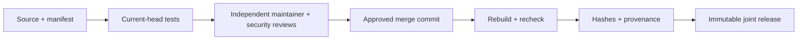

# CGA 插件审批与发布规范 v1.0.0

状态：待审批候选，与插件标准和 SDK 1.0.0 同版本交付。
完整操作说明见[英文审批规范](CGA-Plugin-Approval-v1.0.0-en.md)。

## 生命周期与责任

草稿 → 提交 → 技术验证 → 独立双人审批 → 合并后重建 → 正式发布 → 弃用/撤销。

作者提交源码、清单、测试、外联与数据流、权限、保留策略、许可证、兼容性、
迁移/回滚证据和精确产物哈希。维护者审核宿主边界、功能和可维护性；
安全审查者审核权限、密钥、外联、数据和供应链。二者必须是作者之外的不同人员。
不能把作者填写的 `approved` 字段、审批文件、SDK 校验成功或管理员启用当成批准。

审批绑定 PR 当前完整提交 SHA。提交变化后必须重新审批。
撤回审批、可信审查者要求修改、当前提交检查未成功或审查者配置缺失，都阻止发布。
正式发布只能从该 PR 的实际合并提交重建，不使用移动分支或作者上传的任意 ZIP。

## 可执行门禁

`check_plugin_approval.py` 从 GitHub API 读取 PR、全部审批页和检查记录；
验证仓库、main 目标分支、当前 SHA、作者外双人、最新有效审批及当前检查。
默认必需检查为 `Plugin SDK tests`，其他插件集成测试仍须单独提交并通过。
配置真实人员到仓库变量：

- `CGA_PLUGIN_MAINTAINERS`
- `CGA_PLUGIN_SECURITY_REVIEWERS`
- 可选的 `CGA_PLUGIN_REQUIRED_CHECKS`

仓库所有者必须配置 main 分支保护、失效审批撤销、必需状态检查、CODEOWNERS
以及 `plugin-sdk-release` 环境独立审批/禁止自批。不能由程序虚构审批人员。
**当前检查发现 main 没有分支保护；本文本不代表已完成远端保护配置。**
缺少审查者配置时，发布门禁默认拒绝，而不是默认通过。

## 发布和撤销

正式发布工作流输入版本和已合并审批 PR，验证后共同交付：
中英文标准、审批规范、SDK wheel/源码包、Schema、示例、开发指南、SHA-256。
正式工作流生成 GitHub 构建证明；用户还需验证构建证明与哈希。
本地候选及 GitHub 草稿不是正式审批、可信在线更新或生产部署。

紧急情况可按现有租约机制禁用、从后续镜像排除并发布公告；
保留证据、配置和恢复资料。修复版本仍须重新审查，不能覆盖旧版本或跳过门禁。
现有插件不追认未经证实的历史审批，不因本规范出台而擅自删除用户数据。
